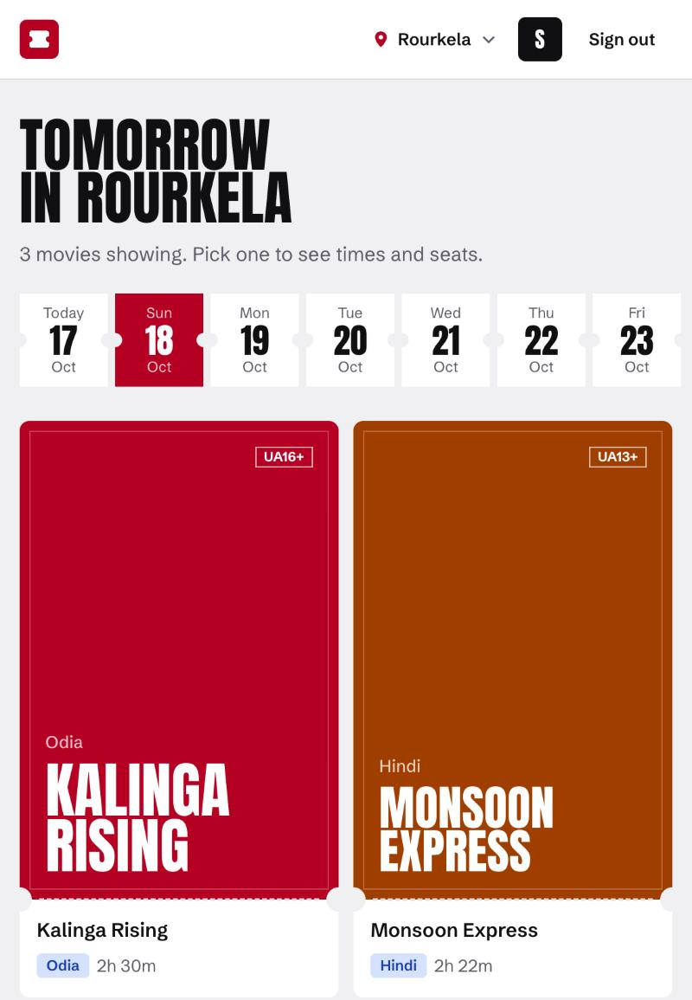
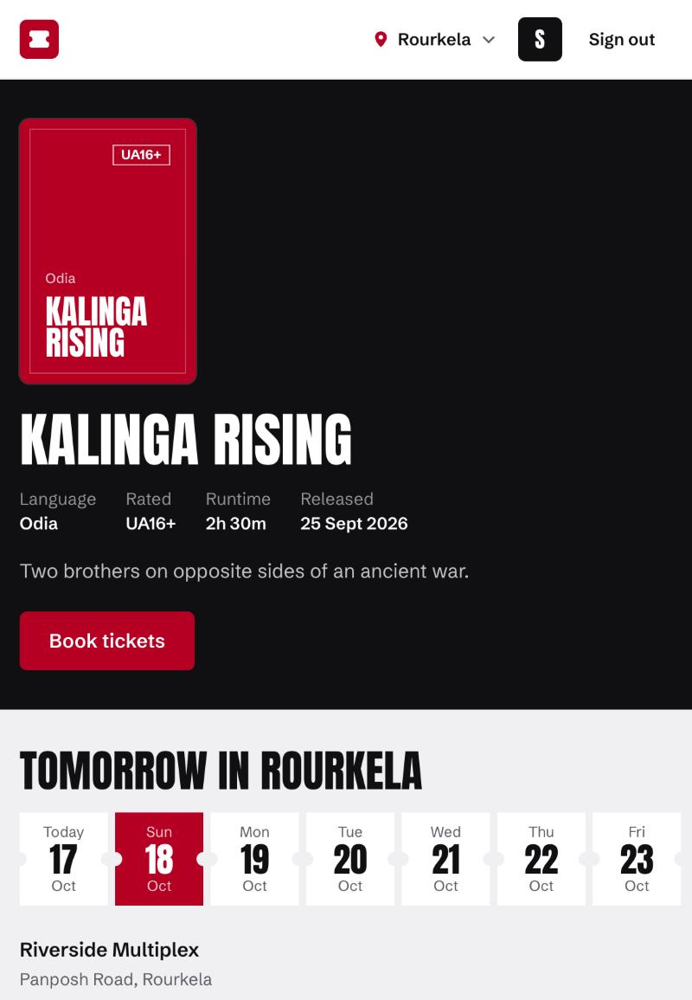
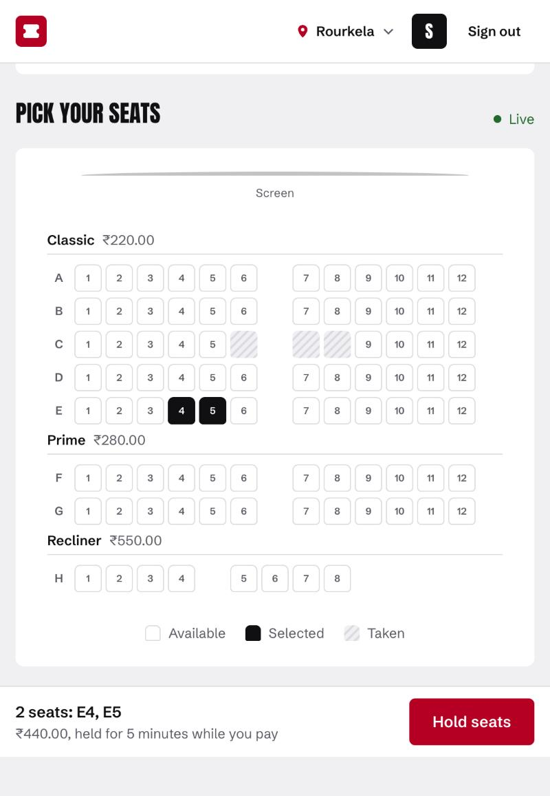
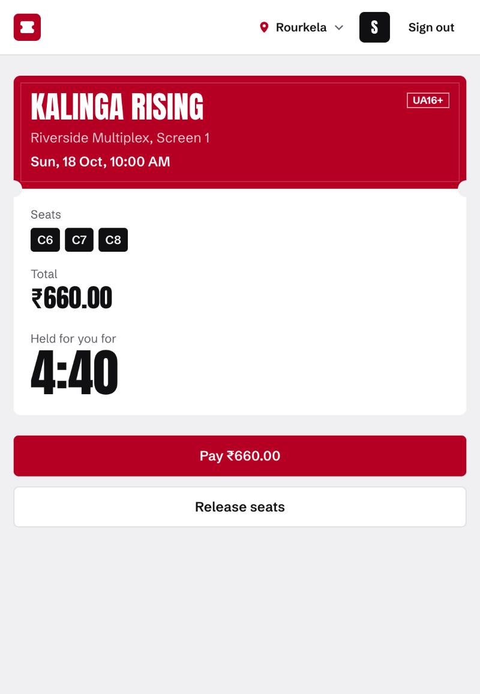
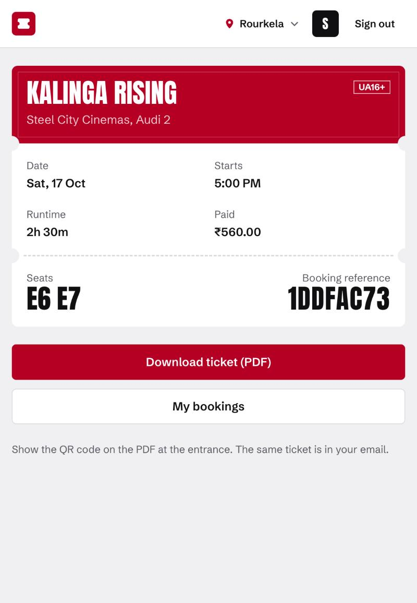

# BookMyTicket

A BookMyShow-style movie ticket booking platform, built to learn and prove distributed-systems
patterns under real contention: seat locking, holds that expire, payment idempotency, reliable
async processing and distributed rate limiting.

> **Status: M6 done (the web app with live seat maps, v0.7.0); M7 next (three replicas behind nginx, load tests, failure drills).** Only what is listed under "What works today" is built. Everything
> else is on the [roadmap](#roadmap) and appears here only once it has a test or a benchmark
> behind it.

## What works today

- API and worker processes with validated configuration, structured logs and graceful shutdown
- Accounts with Better Auth: email + password sign-up and sign-in, sessions shared across
  replicas through Redis (and kept in Postgres), `user` and `admin` roles
- Catalog: admins manage theatres, screens with seat layouts, movies and shows; anyone can
  browse what is playing in a city on a date and see a show's seat map
- Seat holds: up to 5 seats for 5 minutes, all or nothing, safe under contention across replicas
  (200 simultaneous buyers for one seat produce exactly one winner, proven by test), with
  idempotent retries
- Hold expiry: a delayed job per hold releases its seats when the hold runs out, and a sweeper in
  every worker catches any job that was lost, so a crash or a Redis outage never strands seats
- Payments with Razorpay: one order per booking (safe to retry, even after a crash); only a
  signed webhook or the reconciler confirms a booking, never the browser; late, duplicate and
  wrong-amount payments are refunded automatically, and refunds are retried until Razorpay settles
  them. Pay in the web app with Razorpay test mode or the fake payment mode
  ([runbook](docs/runbooks/payments-local.md))
- Emails and tickets: a confirmed booking gets an email with a PDF ticket (QR code), and a refunded
  payment gets a notice with the reason. Every side effect goes through a transactional outbox, so
  it happens if and only if its change committed, and each email is sent once even if a worker
  dies mid-send. Mailpit catches them locally at `localhost:8025`
- Rate limits shared by every replica (one Lua script per check in Redis): sign-in and sign-up 5
  per minute per IP, holds 10 per user, payment orders 5 per user, browsing 120 per IP, with
  `RateLimit-*` headers and `429` + `Retry-After`. Sign-in refuses while Redis is down; everything
  else stays open
- Catalog cache in Redis (60 s), cleared on every replica at once by any admin write; the seat map
  is always live
- A web app (Next.js): browse by city and date, pick seats on a live seat map (seats others take
  turn taken within a second, on any replica, over Server-Sent Events fed by Redis pub/sub), hold
  them with a 5-minute countdown, pay (Razorpay, or a fake mode for development), and get the
  ticket; My bookings lists the rest
- Liveness (`GET /healthz`) and readiness (`GET /readyz`, checks Postgres and Redis)
- SQL migrations with checksums, safe to run from several processes at once
- Unit tests, integration tests against real Postgres and Redis containers, and Playwright browser
  tests of the whole journey (including two browsers watching each other's holds)

## Screens

| Now showing                        | A movie                              | Live seat map                              | Held, 5:00 to pay                          | The ticket                             |
| ---------------------------------- | ------------------------------------ | ------------------------------------------ | ------------------------------------------ | -------------------------------------- |
|  |  |  |  |  |

## Stack

TypeScript (strict) on Node.js 24 · Express 5 · Next.js (App Router) · Tailwind CSS · Better Auth · PostgreSQL 17 with raw SQL via `pg` · Redis 7 · BullMQ · Razorpay · Resend · PDFKit ·
Zod · pino · Vitest + Testcontainers · Docker Compose · GitHub Actions

## Quickstart

Requires Node.js 24 (`nvm use`), Docker Desktop and `make`.

```bash
cp .env.example .env
npm install
make up          # Postgres, Redis, Mailpit
make migrate
make create-admin  # admin account from ADMIN_* in .env
make seed          # demo city, theatres, movies and a week of shows
make dev-api     # http://localhost:4000/readyz
make dev-worker  # hold expiry (second terminal)
make dev-web     # http://localhost:3000 (third terminal)
make test        # unit + integration (starts its own containers)
make e2e         # browser tests (Playwright, fake payments; needs make up migrate seed)
make stack DEMO=1  # the whole app in containers: nginx, 3 API replicas, 2 workers (http://localhost:8080)
```

`make help` lists every target. Full setup notes: [docs/runbooks/local-setup.md](docs/runbooks/local-setup.md).
Paying by hand in Razorpay test mode: [docs/runbooks/payments-local.md](docs/runbooks/payments-local.md).
When an email or refund is missing: [docs/runbooks/queues.md](docs/runbooks/queues.md).
The containerised stack behind nginx: [docs/runbooks/full-stack.md](docs/runbooks/full-stack.md).

## Repository layout

```text
apps/api          Express API (modules mount under /api/v1)
apps/worker       Background jobs: outbox relay, email, hold expiry, reconciliation
apps/web          Next.js frontend; /api/* is forwarded to the API (one origin)
packages/jobs     Background jobs (BullMQ queues and their SQL), shared by API and worker
packages/payments Razorpay client, a fake for tests, signature checks
packages/platform Server-side building blocks: env, logger, Postgres, Redis, migrations
packages/shared   Types and constants shared with the frontend
db/migrations     Forward-only SQL migrations (NNNN_name.sql)
infra             Docker Compose, Dockerfiles, nginx (k6 arrives later in M7)
docs              Architecture, ADRs, runbooks, benchmarks, lessons
```

## Docs

- [Architecture](docs/architecture.md)
- [Architecture Decision Records](docs/adr/)
- [Lessons learned](docs/lessons.md)
- [Changelog](CHANGELOG.md)

## Roadmap

| Milestone | Tag      | Scope                                                      |
| --------- | -------- | ---------------------------------------------------------- |
| M0        | `v0.1.0` | Foundations: repo, infra, migrations, CI                   |
| M1        | `v0.2.0` | Accounts and catalog                                       |
| M2        | `v0.3.0` | Seat holds and concurrency (three strategies, benchmarked) |
| M3        | `v0.4.0` | Razorpay payments, webhooks, refunds, reconciliation       |
| M4        | `v0.5.0` | Outbox, queues, email tickets                              |
| M5        | `v0.6.0` | Distributed rate limiting and caching                      |
| M6        | `v0.7.0` | Next.js frontend                                           |
| M7        | `v0.8.0` | Three replicas, load tests, failure drills                 |
| M8        | `v1.0.0` | Deployment and release                                     |

## Results

- **Seat holds:** 0 double bookings with 200 buyers on one seat across 3 replicas, for all three
  locking strategies. Putting a Redis lock in front of Postgres cut median hold latency under
  contention from 193 ms to 7 ms, which overturned the first choice of default
  ([benchmark](docs/benchmarks/m2-hold-strategies.md), [ADR 0005](docs/adr/0005-seat-hold-strategy.md)).
- **Payments:** forged, redelivered (including 10 copies at once), reordered, late, double and
  never-delivered webhooks are all tested, and six money-and-seat invariants are checked after
  every one: no booking is confirmed without exactly one applied payment, and every other captured
  payment is refunded exactly once ([ADR 0007](docs/adr/0007-payment-confirmation.md)).
- **Async processing:** an email worker killed with `SIGKILL` in the middle of a batch of 20 loses
  no email and sends none twice; two outbox relays running at once queue each event exactly once;
  a relay killed between queuing and committing leaves one job, not two
  ([ADR 0008](docs/adr/0008-transactional-outbox.md), [ADR 0009](docs/adr/0009-email-delivery.md)).
- **Rate limiting:** three API instances with separate Redis connections let exactly 10 of one
  user's 30 holds through, not 30; 50 simultaneous checks against a budget of 10 allow exactly 10
  ([ADR 0010](docs/adr/0010-rate-limiting.md)).
- **Under load, behind nginx:** 200 buyers fired at 10 seats through 3 replicas left each seat
  with exactly one owner, and 79% of the losers were turned away by the Redis pre-lock before
  reaching Postgres. 300 people watching one seat map heard all 3,000 seat changes, p95 108 ms.
  One address got exactly 5 sign-in attempts a minute across 3 replicas. A second and third
  replica cut browse p99 from 497 ms to 44 ms, but raised peak throughput only 32% on one 8-core
  laptop ([load tests](docs/benchmarks/m7-load.md), [ADR 0016](docs/adr/0016-load-testing.md)).
