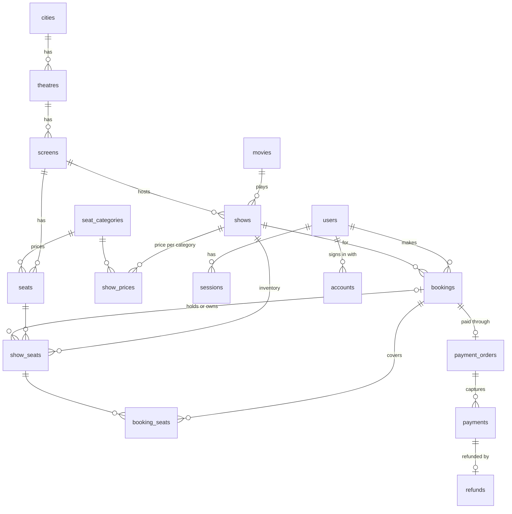

# Architecture

The living summary of how BookMyTicket fits together. It changes in the same PR as the design;
the reasoning behind each choice lives in [`adr/`](adr/).

## Shape

A modular monolith. One API codebase runs as several identical, stateless replicas behind nginx,
and separate worker processes handle everything slow or retryable.

```text
browser ──HTTPS──▶ nginx ──▶ api-1 │ api-2 │ api-3 ──▶ PostgreSQL 17 (source of truth)
                     ▲                      │      └──▶ Redis 7 (pre-locks, rate limits, cache, queues)
Razorpay ──webhooks──┘                      ▼
                                   worker processes ──▶ Resend (email), Razorpay (reconcile, refunds)
```

## Rules the design depends on

1. **Postgres decides seat ownership.** A seat changes owner only through a conditional update on
   its own `show_seats` row. Redis may reject requests early but never grants a seat.
2. **No external call inside a transaction.** A booking is two short transactions (hold, then
   confirm) with the payment in between.
3. **The webhook confirms payments**, never the browser callback. The reconciler covers webhooks
   that never arrive.
4. **Side effects go through the outbox.** A state change and the event announcing it commit together.
5. **Everything retried is idempotent:** idempotency keys on POSTs, event-ID dedupe on webhooks,
   `processed_messages` for queue consumers.
6. **The API holds no state in memory.** Any replica can serve any request.

## Code layout

| Path                | Role                                                                                         |
| ------------------- | -------------------------------------------------------------------------------------------- |
| `apps/api`          | HTTP layer. Each module in `src/modules/<name>/` has `routes`, `service`, `repo`, `schemas`  |
| `apps/worker`       | Queue consumers, outbox relay, hold-expiry sweeper, payment reconciler                       |
| `packages/jobs`     | Queue names, job payloads and their SQL, shared by the API (producer) and worker (consumer)  |
| `packages/payments` | Razorpay client over `fetch`, an in-memory fake with the same interface, signature checks    |
| `packages/platform` | Server-only building blocks: env parsing, logger, Postgres pool, Redis, migrations, shutdown |
| `packages/shared`   | Types, schemas and constants safe to use in the browser                                      |
| `db/migrations`     | Forward-only SQL, applied by `packages/platform/src/migrate.ts`                              |

Routes parse and validate input, services hold business rules and own transactions, repos hold
SQL. Tests call services directly against a real database for concurrency work.

## Data model

Identity, catalog, bookings and payments as of M3. Seat ownership lives only in `show_seats`; bookings (M2) change
it with a conditional `UPDATE` on those rows. A booking has at most one Razorpay order; every captured
payment is recorded, at most one confirms the booking, and any other is refunded in full.



| Rule                                                                                | Enforced by                                                                |
| ----------------------------------------------------------------------------------- | -------------------------------------------------------------------------- |
| Two scheduled shows never overlap on one screen                                     | `shows_no_overlap` exclusion constraint                                    |
| One seat per row and number, and per grid cell, on a screen                         | `seats_screen_row_number_key`, `seats_screen_grid_key`                     |
| One inventory row per seat per show                                                 | `show_seats_show_seat_key`                                                 |
| Held seats have a booking and an expiry; booked seats a booking; free seats neither | `show_seats_hold_consistency`                                              |
| At most one pending booking per user per show                                       | `bookings_one_pending_per_user_show`                                       |
| Money is positive whole paise                                                       | `CHECK (price_paise > 0)` ([ADR 0003](adr/0003-money-as-integer-paise.md)) |
| One account per email, ignoring case                                                | `users_email_lower_key`                                                    |
| A booking has at most one order, for exactly its total, which is then frozen        | `payment_orders_booking_key`, `payment_orders_amount_matches_booking`      |
| At most one payment confirms a booking                                              | `payments_one_applied_per_order`                                           |
| A refund is for the full payment, at most once per payment                          | `refunds_full_amount`, `refunds_payment_key`                               |
| A Razorpay order, payment, refund or webhook event is recorded once                 | unique keys on each Razorpay id, `payment_webhook_events_pkey`             |

Times are stored as `timestamptz` in UTC. Each city has a `timezone` (default `Asia/Kolkata`)
that decides which shows fall on a given calendar date there.

## Life of a hold

```text
POST /bookings ──▶ [Redis pre-lock] ──▶ hold transaction (Postgres) ──commit──▶ queue hold-expiry job
                                                                                  (delay = expires_at + 1 s)
worker: job fires ─────────────┐
worker: sweeper every 30 s ────┴─▶ UPDATE ... WHERE status = 'PENDING_PAYMENT' AND expires_at <= now()
                                   booking EXPIRED, seats still pointing at it AVAILABLE
```

A seat whose hold has run out is free to the next buyer straight away; the job and the sweeper
only make the stored state catch up ([ADR 0005](adr/0005-seat-hold-strategy.md),
[ADR 0006](adr/0006-hold-expiry.md)).

## Status by milestone

| Area                          | Milestone | State   |
| ----------------------------- | --------- | ------- |
| Foundations                   | M0        | Done    |
| Accounts and catalog          | M1        | Done    |
| Seat holds                    | M2        | Done    |
| Payments                      | M3        | Planned |
| Outbox and queues             | M4        | Planned |
| Rate limiting and caching     | M5        | Planned |
| Frontend                      | M6        | Planned |
| Replicas, load, failure tests | M7        | Planned |
| Deployment                    | M8        | Planned |
